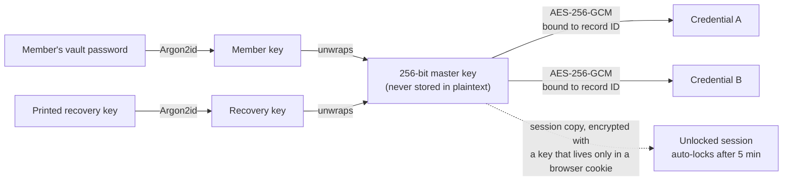

<!-- Header banner -->

  

  
  

  

  
  
  
  

---

For more than six years I've worked out what really happened on devices and systems, and my findings have been used in real legal proceedings. I also build web apps, backends and the tools that make investigations faster. Each job feeds the other. Forensics has shown me exactly how systems get abused and how evidence gets lost, so I build software with that in mind.

I trained as a software developer at BCIT and work in English and Spanish. **I'm open to remote roles and freelance projects in development, DFIR, or both.**

---

### 🔍 Digital forensics

Since 2020 I've worked on cases involving internal fraud, data leaks, email scams and unauthorized access. I've pulled evidence from laptops, phones, servers, bank databases and corporate email, and my reports have supported real legal proceedings, including court-appointed expert work.

I also do OSINT and reverse engineer Android apps to trace the people and servers behind illegal streaming networks.

**Tools:** Magnet AXIOM · Oxygen Forensic Detective · Tableau · REA · WhisperX

---

### 🛠️ Software development

- **Web apps, end to end.** I build with Django, Node/Express, React/Next.js and PostgreSQL, from the database schema to deployment.
- **WordPress and WooCommerce that hold up in production.** That includes custom PHP, payment gateways, checkout changes, and the server work around them.
- **Infrastructure and security.** I run AWS EC2 servers on Ubuntu, handle DNS, SSL and hosting migrations, and respond when a site gets hacked.

My day job is **Head of IT** at a company of about 40 people. I keep everything running: email, servers, access control, and the websites for several brands.

---

### Things I've built

**🛡️ Cerbero** · `Django` `PostgreSQL` `HTMX` `Docker`
We were tracking every laptop, phone and password for three companies in a pile of Excel files. Cerbero replaced them. It shows who has what, what's on loan and when it's due back, which licenses are about to expire, and the full history of every change. It also has an encrypted password vault, which was my favourite part to build.

<b>How the credential vault works</b> (click to expand)

**🗂️ Lions Gate** · `Next.js` `TypeScript` `Prisma` `SQLite`
My own case manager for forensic work. It knows which disk holds the evidence for each case, even when Windows assigns the drive a different letter, and it generates the handover documents clients sign. Everything stays on my machine. No cloud, and nothing leaves the PC.

**🎙️ Audio transcription for evidence** · `Python` `WhisperX`
Transcribing recordings by hand used to take me days. This runs on the GPU, separates the speakers and timestamps every line so I can match it against the rest of the evidence.

**🔨 The Tool Village** · `Next.js` `Express` `PostgreSQL`
Our BCIT capstone: a marketplace for the trades community, with regular listings plus Dutch and reverse auctions. There were five of us and we had four weeks. I worked across the backend and frontend, mainly on the auctions, auth and the database schema.

**💳 Payphone for WordPress** · `PHP`
A payment integration for a WordPress site. Payments are verified on the server and every transaction is logged.

**🚨 Cleaning up a hacked site** · `AWS` `Linux`
A production WordPress site on EC2 got hacked. I locked it down, figured out how the attacker got in, cleaned it up and hardened the server.

**🕷️ [WECPSIE](https://github.com/Staraguay/WECPSIE)** · `Python` `Selenium`
A web crawler.

---

### What I'm working on now

- **Cerbero phase 2:** PDF handover and return forms, and onboarding/offboarding checklists
- Building a news outlet's website from a Figma design
- Redesigning my firm's website
- Going deeper into **Angular and TypeScript**
- Turning my forensic scripts into small open-source tools

---

### Stack

  
    
  

  <b>Also:</b> Caddy · Oracle (forensic analysis) · <b>Forensics:</b> Magnet AXIOM · Oxygen Forensic Detective · Tableau · REA · WhisperX

---

### GitHub activity

  

<picture>
  <source media="(prefers-color-scheme: dark)" srcset="https://raw.githubusercontent.com/Staraguay/Staraguay/output/github-contribution-grid-snake-dark.svg"/>
  <source media="(prefers-color-scheme: light)" srcset="https://raw.githubusercontent.com/Staraguay/Staraguay/output/github-contribution-grid-snake.svg"/>
  
</picture>

---

### Let's talk

I'd like to hear from you if you need any of these:
- a developer who thinks like an investigator
- a forensic examiner who can also write the code
- someone to work out what happened on a device, a server or a mailbox

💼 **[LinkedIn](https://www.linkedin.com/in/sebastian-taraguay-4a1824170/)**

